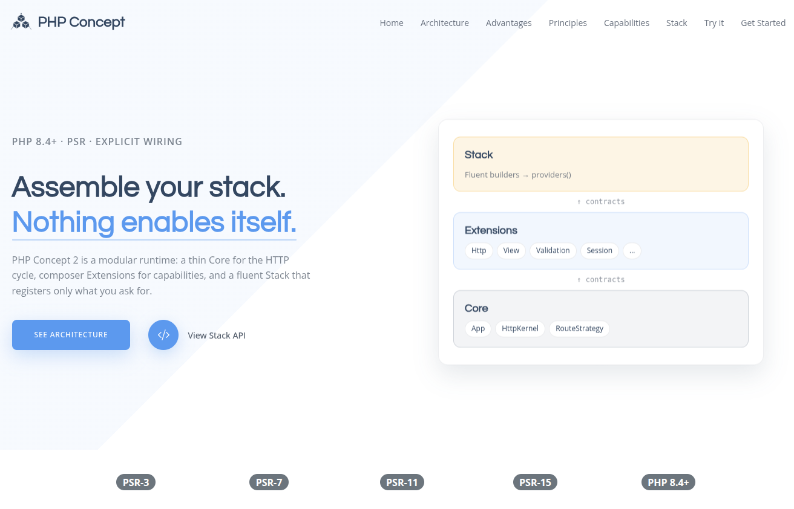

<p align="center">
  <a href="https://php-concept.github.io/concept-docs-2/">
    
  </a>
</p>

<h1 align="center">PHP Concept Skeleton</h1>

<p align="center">
  <strong>A FormSite-level starter for PHP Concept 2</strong><br>
  Thin <a href="https://github.com/php-concept/concept-core-2">Core</a> · opt-in Extensions · explicit
  <a href="https://github.com/php-concept/concept-stack">ConceptStack</a>
</p>

<p align="center">
  <a href="https://php-concept.github.io/concept-docs-2/"></a>
  <a href="LICENSE"></a>
  <a href="https://www.php.net/releases/8.4/en.php"></a>
</p>

<p align="center">
  
</p>

---

PHP Concept is a **modular PHP runtime** built on PSR standards. You assemble capabilities
deliberately — nothing enables itself. This repository is the **clone-ready application
skeleton**: HTTP forms, CSRF, Twig, validation, sessions, logging, and error pages.
Database, Components, and other product add-ons stay opt-in.

## About PHP Concept

- **[Thin Core](https://github.com/php-concept/concept-core-2)** — container, routing, and dispatch. No View, Session, or Database inside the kernel.
- **[ConceptStack](https://github.com/php-concept/concept-stack)** — fluent builders (`addHttp()`, `addView()`, …) that produce an ordered list of service providers.
- **Extensions** — separate Composer packages. Paths, flags, and connections are constructor arguments from glue code — packages do not read a global config bag.
- **PSR-first** — HTTP (PSR-7/15), Container (PSR-11), Logging (PSR-3), and friends stay interoperable.
- **Visible wiring** — bootstrap shows exactly what lands in the container. No silent auto-discovery of half the ecosystem.

## Requirements

- PHP 8.4+
- [Composer](https://getcomposer.org/) 2.x
- A web server (or Docker) with the document root set to `public/`

## Installation

```bash
composer create-project php-concept/skeleton-2 my-app
# or: git clone git@github.com:php-concept/concept-skeleton-2.git my-app && cd my-app && composer install

cp .env.example .env
composer ci
```

Point your web server at `public/`, or start the local Docker stack:

```bash
cp docker-compose.yml.example docker-compose.yml
docker compose up -d --build
# → http://localhost:8080
```

## Documentation

- **[Documentation](https://php-concept.github.io/concept-docs-2/)**
- **[concept-core-2](https://github.com/php-concept/concept-core-2)** — HTTP kernel and routing
- **[concept-stack](https://github.com/php-concept/concept-stack)** — fluent capability recipes
- [`AGENTS.md`](AGENTS.md) — agent-oriented map for this repo

## License

The PHP Concept Skeleton is open-source software licensed under the [MIT license](LICENSE).
